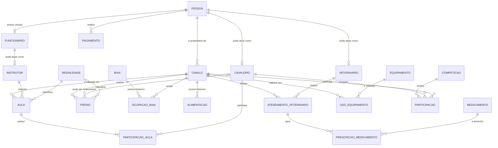

# Modelo Entidade-Relacionamento (MER) — EquiData

Diagrama em Mermaid. Para visualizar, cole o conteúdo em https://mermaid.live.

## Entidades e atributos principais

- **Pessoa** (id_pessoa PK, nome, cpf, data_nascimento, telefone, email)
- **Funcionario** (id_funcionario PK, id_pessoa FK, cargo, data_admissao, ativo)
- **Instrutor** (id_instrutor PK, id_funcionario FK, especialidade, qualificacao)
- **Veterinario** (id_veterinario PK, id_pessoa FK, registro_profissional, telefone_emergencia)
- **Cavaleiro** (id_cavaleiro PK, id_pessoa FK, nivel_experiencia, data_inicio)
- **Cavalo** (id_cavalo PK, nome, raca, sexo, data_nascimento, pelagem, microchip, id_proprietario FK)
- **Modalidade** (id_modalidade PK, nome, descricao)
- **Aula** (id_aula PK, data_hora, duracao_minutos, id_cavalo FK, id_instrutor FK, id_modalidade FK)
- **Participacao_Aula** (id_aula PK/FK, id_cavaleiro PK/FK, presenca, observacao)
- **Treino** (id_treino PK, id_cavalo FK, id_cavaleiro_responsavel FK opcional, id_modalidade FK opcional, data_hora, duracao_minutos, distancia_km, velocidade_media_kmh)
- **Baia** (id_baia PK, identificacao, localizacao, capacidade)
- **Ocupacao_Baia** (id_ocupacao PK, id_baia FK, id_cavalo FK, data_inicio, data_fim)
- **Alimentacao** (id_alimentacao PK, id_cavalo FK, descricao, quantidade, frequencia, data_inicio, data_fim)
- **Atendimento_Veterinario** (id_atendimento PK, id_cavalo FK, id_veterinario FK, data_atendimento, descricao_procedimento, diagnostico)
- **Medicamento** (id_medicamento PK, nome, fabricante, descricao)
- **Prescricao_Medicamento** (id_prescricao PK, id_atendimento FK, id_medicamento FK, dosagem, via_administracao, frequencia, data_inicio, data_fim)
- **Equipamento** (id_equipamento PK, nome, tipo, estado_conservacao, identificacao)
- **Uso_Equipamento** (id_uso PK, id_cavalo FK, id_equipamento FK, data_inicio, data_fim)
- **Competicao** (id_competicao PK, nome, data_competicao, local, descricao)
- **Participacao** (id_participacao PK, id_competicao FK, id_cavaleiro FK, id_cavalo FK, colocacao, pontuacao, resultado)
- **Pagamento** (id_pagamento PK, id_pessoa_pagadora FK, data_pagamento, valor, status, descricao, forma_pagamento)

## Restrições de negócio implementadas no banco

1. Cada cavalo possui um proprietário obrigatório (`id_proprietario NOT NULL`).
2. Cada aula possui exatamente um cavalo, instrutor e modalidade (`NOT NULL` nas FKs).
3. Uma aula pode ter vários cavaleiros, por meio de `participacao_aula`.
4. Um treino sempre está associado a um cavalo e possui data/hora e duração.
5. Um treino pode ter cavaleiro responsável e modalidade opcionais.
6. A ocupação de baia mantém histórico por período.
7. Índices únicos parciais e gatilhos impedem sobreposição de ocupação para uma mesma baia ou cavalo.
8. Atendimento veterinário sempre identifica cavalo, veterinário, data e procedimento.
9. Prescrição relaciona atendimento e medicamento, armazenando dosagem e frequência no contexto da prescrição.
10. Participação em competição relaciona competição, cavaleiro e cavalo; a combinação é única.
11. Valores, durações, distâncias e colocações possuem verificações de domínio.

**Nota de modelagem:** a participação mínima de um cavaleiro em cada aula é garantida pelo processo de cadastro/transação da aplicação, pois uma restrição CHECK comum não consegue exigir a existência de linhas em outra tabela. O banco representa a relação e impede duplicidade por aula/cavaleiro.
